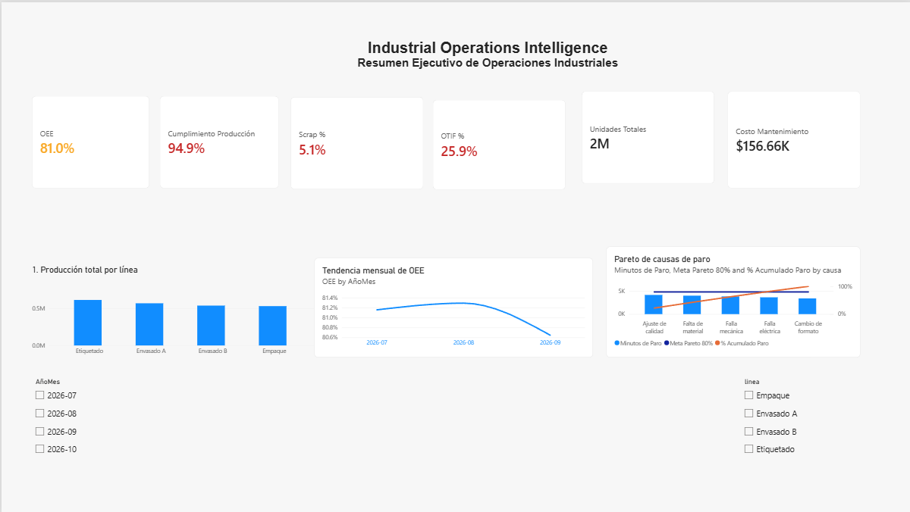
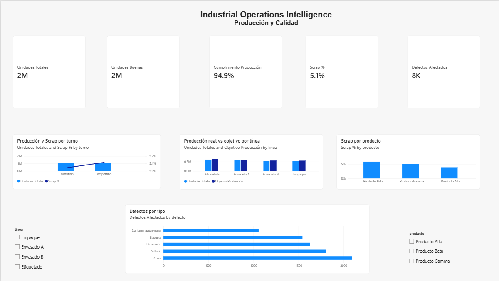
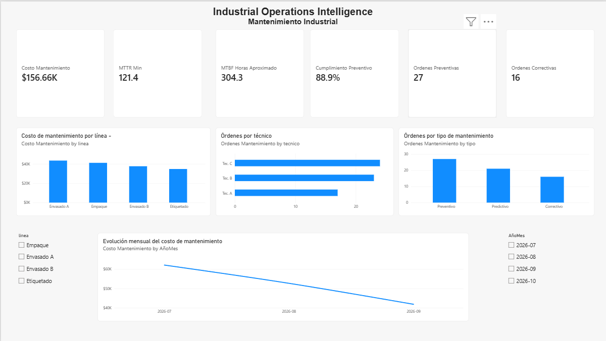
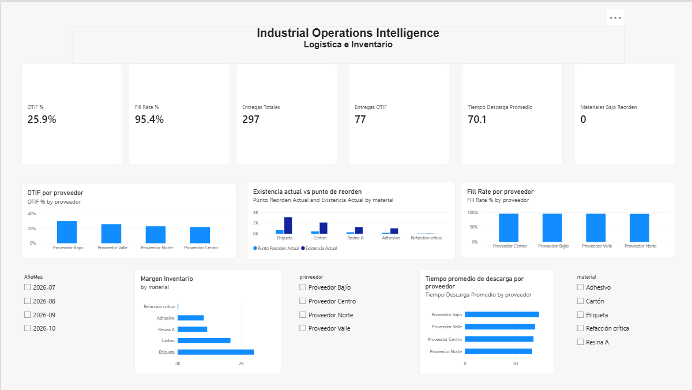
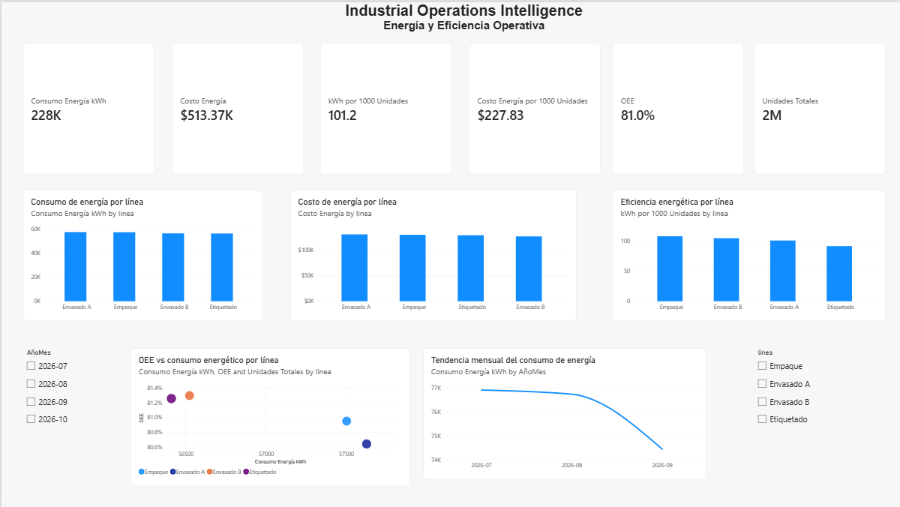
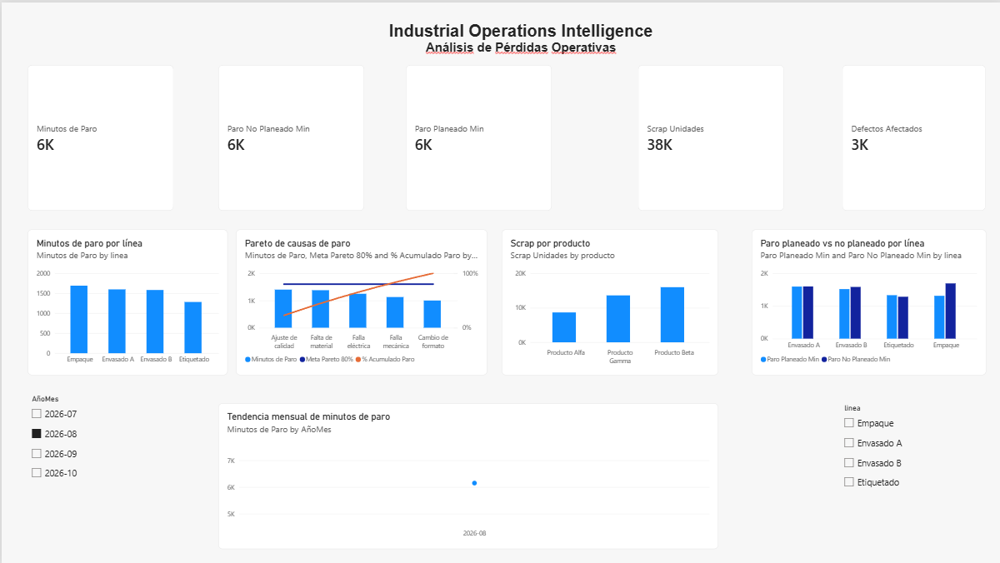

# Industrial Operations Intelligence

Proyecto de **Business Intelligence en Power BI** enfocado en el análisis y monitoreo de operaciones industriales. El dashboard integra información de producción, calidad, mantenimiento, energía, inventario y logística para facilitar la lectura de indicadores operativos y detectar pérdidas, desviaciones y oportunidades de mejora.

> Proyecto de portafolio desarrollado por **Alan Daniel Martínez Martínez** con datos simulados para fines académicos y de demostración.



## Objetivo

Construir una solución de análisis industrial que concentre los principales indicadores de operación en un solo reporte interactivo y permita analizar el desempeño por periodo, línea, producto, proveedor y material.

## Páginas del dashboard

- **Resumen Ejecutivo**: OEE, cumplimiento de producción, scrap, OTIF, unidades producidas, costo de mantenimiento, tendencia de OEE y Pareto de paros.
- **Producción y Calidad**: producción real vs objetivo, unidades buenas, scrap por producto, defectos por tipo y análisis por turno.
- **Mantenimiento**: MTTR, MTBF, mantenimiento preventivo/correctivo, costos, técnicos y evolución mensual.
- **Logística e Inventario**: OTIF, Fill Rate, entregas, descarga, inventario actual, punto de reorden y margen de inventario.
- **Energía y Eficiencia**: consumo y costo energético, intensidad energética, OEE y relación entre energía y producción.
- **Análisis de Pérdidas**: minutos de paro, paros planeados/no planeados, scrap, defectos y Pareto de causas.

## KPIs principales

`OEE` · `Disponibilidad` · `Rendimiento` · `Calidad` · `Scrap %` · `Cumplimiento de Producción` · `MTTR` · `MTBF` · `Cumplimiento Preventivo` · `OTIF` · `Fill Rate` · `Consumo de Energía` · `Costo de Energía` · `Materiales Bajo Reorden`

## Modelo de datos

El reporte utiliza un modelo tipo estrella con tablas de hechos para producción, calidad, mantenimiento, paros, energía, inventario y logística, conectadas a dimensiones de fecha, línea, producto, proveedor y material.

Principales dimensiones:

- `DimFecha`
- `DimLinea`
- `DimProducto`
- `DimProveedor`
- `DimMaterial`

Principales tablas de hechos:

- `T_Produccion`
- `T_Calidad`
- `T_Mantenimiento`
- `T_Paros`
- `T_Energia`
- `T_Inventario`
- `T_Logistica`

## Tecnologías utilizadas

- **Microsoft Power BI Desktop**
- **DAX** para medidas e indicadores
- **Power Query** para preparación de datos
- **Excel** como fuente de datos del proyecto
- Modelado dimensional y análisis de KPIs industriales

## Estructura del repositorio

```text
industrial-operations-intelligence/
├── Industrial_Operations_Intelligence_Alan_Martinez.pbix
├── README.md
├── data/
│   └── datos_operacion_industrial.xlsx
├── assets/
│   ├── resumen-ejecutivo.png
│   ├── produccion-calidad.png
│   ├── mantenimiento.png
│   ├── logistica-inventario.png
│   ├── energia-eficiencia.png
│   └── analisis-perdidas.png
└── docs/
    └── modelo-datos.md
```

## Capturas

### Producción y Calidad


### Mantenimiento


### Logística e Inventario


### Energía y Eficiencia


### Análisis de Pérdidas


## Cómo abrir el proyecto

1. Descarga el archivo `Industrial_Operations_Intelligence_Alan_Martinez.pbix`.
2. Ábrelo con **Power BI Desktop**.
3. Utiliza los filtros de fecha, línea, producto, proveedor y material para explorar el reporte.

## Qué demuestra este proyecto

Este proyecto muestra habilidades en modelado de datos, preparación de información, creación de medidas DAX, diseño de dashboards, análisis de KPIs industriales y comunicación visual de resultados para apoyar la toma de decisiones.
